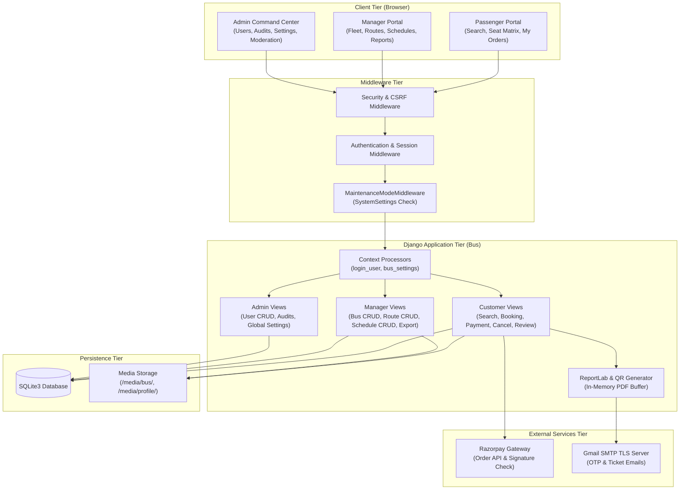
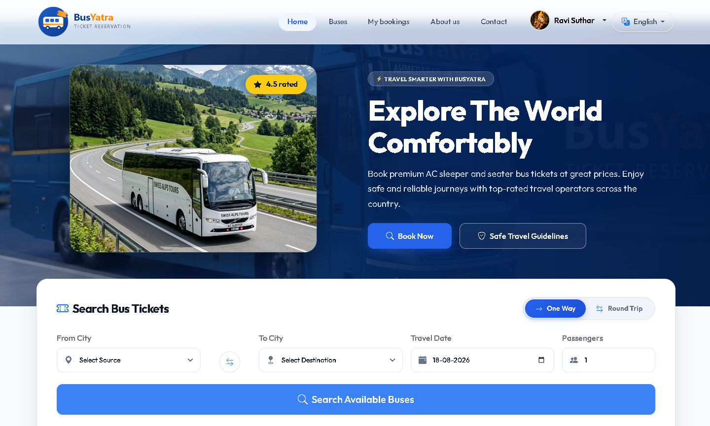
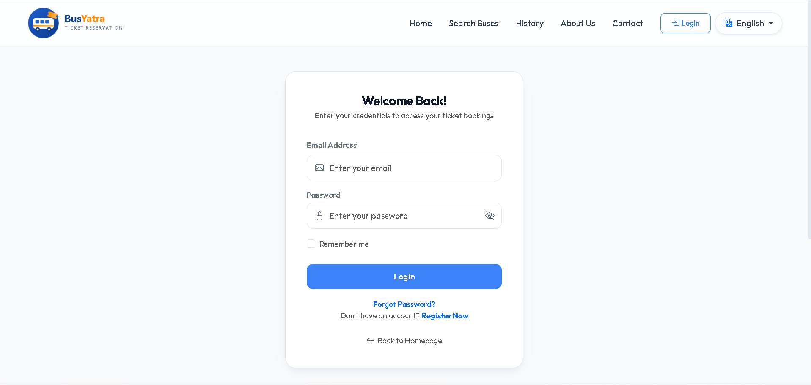
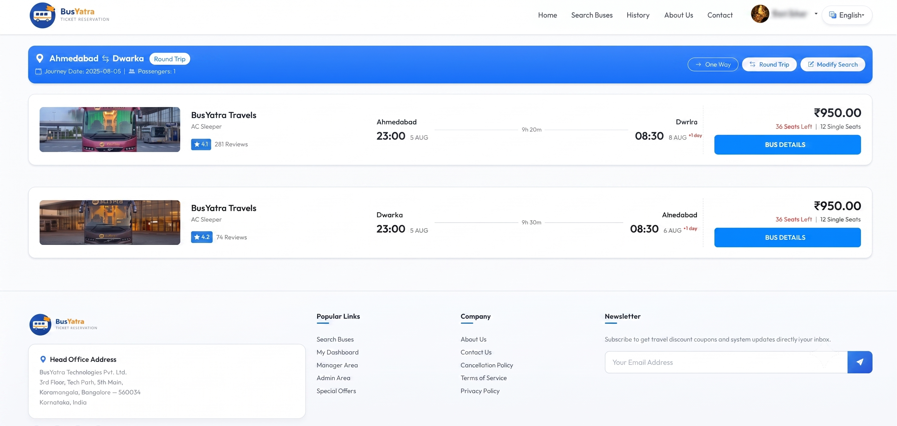
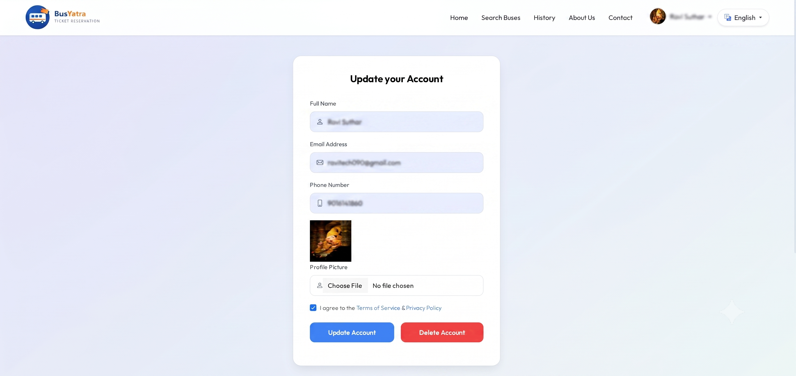
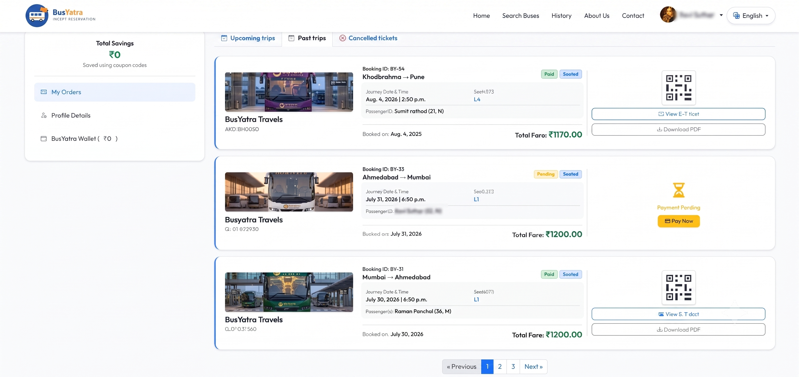
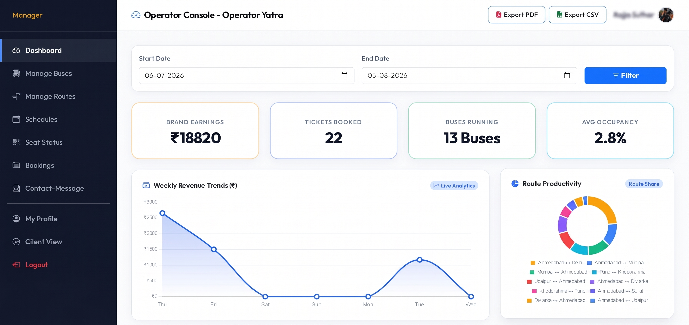
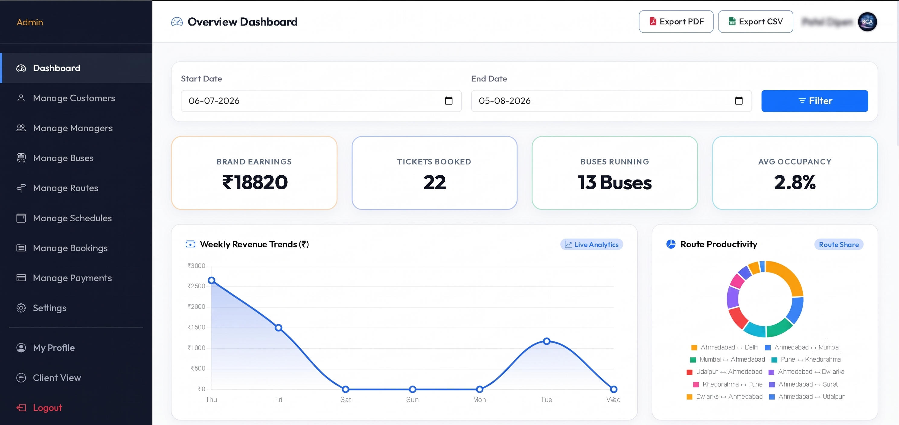

# 🚌 BusYatra

[](https://www.djangoproject.com/)
[](https://www.python.org/)
[](https://getbootstrap.com/)
[](https://www.sqlite.org/)
[](https://razorpay.com/)
[](#-license)

A modern, production-grade bus ticket reservation and fleet management web platform built with Python (Django). BusYatra streamlines intercity bus travel for passengers with real-time seat selection, one-way and round-trip booking flows, online payments via Razorpay, and automated PDF e-ticketing with dynamic QR codes. 

The system provides robust Role-Based Access Control (RBAC) with dedicated management interfaces for `customer` passengers, `manager` bus operators, and `admin` system executives.

---

## Project Description

**BusYatra** is a full-stack bus ticket reservation and transport management web application built with Django. It automates ticketing workflows, inventory allocation, and administrative governance for intercity bus travel.

The platform provides three purpose-built portals:
- A customer-facing `user` portal where passengers can search bus routes, view real-time seat matrices, reserve individual seats, complete transactions via Razorpay, obtain instant PDF e-tickets with embedded QR verification codes, manage trip histories, and submit verified journey ratings.
- A dedicated `manager` portal for bus operators to oversee fleet operations, register bus vehicles, configure route itineraries, schedule departures and arrivals, monitor real-time seat occupancy, and export analytical operational reports in PDF and CSV formats.
- A centralized `admin` dashboard empowering platform administrators with global governance over all customers, bus operators, routes, schedules, payment audit logs, customer inquiries, and system-wide configurations such as convenience fees, GST, refund windows, and platform maintenance mode.

---

## Key Features

### 🧑‍💻 Passenger / Customer Features
- **Route Search & Real-Time Availability** -- Search buses across cities, filter by travel date, and view dynamic live seat availability and pricing in real time.
- **Interactive Visual Seat Booking** -- Graphical 2D seat matrix distinguishing window, aisle, sleeper, and seater berths with database-level seat locking (`SeatBooking`) to prevent concurrent double-booking.
- **Unified Round-Trip Reservation** -- Single checkout workflow for selecting outbound and return buses with linked UUID (`round_trip_id`) tracking.
- **Razorpay Online Payment Integration** -- Secure checkout modal supporting UPI, credit/debit cards, and net banking with automated sandbox fallback for development environments.
- **Automated PDF E-Ticket & Email Dispatch** -- In-memory dynamic PDF ticket generation featuring journey details, passenger manifests, and scannable QR verification codes delivered automatically via Gmail SMTP TLS.
- **Customer "My Orders" Hub** -- Structured booking overview categorized into **Upcoming Trips**, **Past Trips**, and **Cancelled Tickets** with pagination and re-download options.
- **Self-Service Cancellation & Dynamic Refund Policy** -- Customer cancellation workflow that automatically calculates refund tiers based on departure proximity (100% refund before 24 hours, 50% refund before 12 hours).
- **Verified Passenger Ratings & Reviews** -- Verified passengers can submit, edit, or delete 1-to-5 star ratings and feedback for completed bookings.
- **Authentication & Self-Service Account Management** -- Session-based user registration, login, profile photo upload, contact detail management, email OTP password recovery (`forgot-password`, `verify-forgot-otp`, `reset-password`), and account deletion.

### 👨‍💼 Bus Fleet Manager Features
- **Dedicated Operator Dashboard** -- Real-time operational overview with metric cards for total assigned buses, active routes, booked passengers, and total earnings.
- **Bus Fleet CRUD Operations** -- Complete lifecycle management for buses including bus name, vehicle registration number, bus type (A/C Sleeper, Non-A/C Seater), total seat capacity, fare calculation, and exterior photo uploads.
- **Intercity Route Network Management** -- Interface to add, modify, and delete travel routes specifying origin, destination, distance in kilometers, and estimated journey duration.
- **Timetable & Schedule Management** -- Timetable management for departures, arrivals, and travel dates with real-time status toggling (`Available` / `Cancelled`).
- **Live Seat Layout Oversight** -- Visual matrix displaying occupied versus vacant seats for every scheduled bus.
- **Manifest Inspection & Operator Cancellation** -- Passenger booking oversight with operator-level cancellation privileges.
- **Operational Reporting & Exports** -- Generate and export operational data into downloadable **PDF** and **CSV** reports for offline accounting.
- **Assigned Bus Feedback Monitoring** -- Direct review interface to inspect customer ratings and feedback specifically assigned to the operator's buses.

### 🛡️ System Administrator Features
- **Centralized Executive Command Center** -- Platform-wide KPI counters displaying total platform revenue, total registered passengers, active operators, total fleet size, and route coverage.
- **User Lifecycle Governance** -- Comprehensive CRUD administration for both passenger (`customer`) and fleet operator (`manager`) accounts.
- **Fleet & Route System Oversight** -- Global administration over all buses, routes, and schedules across every operator on the platform.
- **Financial Audit & Payment Ledger** -- Transaction ledger recording Razorpay order IDs, payment IDs, cryptographic signatures, payment statuses, and timestamps.
- **Review Moderation & Homepage Showcase** -- Moderate customer reviews with the ability to toggle the `is_featured` showcase flag on the public landing page or delete abusive entries.
- **Support Inquiry Management** -- Centralized inbox to review, track, and manage customer inquiries submitted through the public Contact form.
- **Global Platform Configuration** -- Dynamic configuration panel controlling application branding, currency display, welcome bonus, cashback percentage, GST percentage, convenience fee, refund cutoff thresholds, and platform maintenance mode toggle.

---

## Technology Stack

| Layer | Technology | Purpose in Project |
| :--- | :--- | :--- |
| **Backend Framework** | [Django](https://www.djangoproject.com/) 5.x / 6.x | Core MVT web framework, ORM, session handling, context processors, and middleware |
| **Language** | [Python](https://www.python.org/) 3.10+ | Primary server-side programming language |
| **Database** | [SQLite3](https://www.sqlite.org/) | Relational database storage (`db.sqlite3`) for local development and demonstration |
| **Frontend Architecture** | HTML5, CSS3, JavaScript (ES6) | Responsive templates, client-side seat selection, dynamic calculations, and AJAX calls |
| **UI Framework** | [Bootstrap 5](https://getbootstrap.com/) | Responsive grid, interactive modals, cards, badges, and responsive tables |
| **Icons** | [Font Awesome 6](https://fontawesome.com/) | UI iconography across navigation menus, dashboards, and booking steps |
| **Payment Gateway** | [Razorpay Python SDK](https://razorpay.com/) | Payment order generation, client-side checkout modal, and webhook/callback signature validation |
| **Document Generation** | [ReportLab](https://www.reportlab.com/) | Dynamic in-memory PDF document rendering for passenger tickets and analytics reports |
| **QR Code Engine** | [qrcode](https://pypi.org/project/qrcode/) & ReportLab | Dynamic QR verification code generation embedded into digital e-tickets |
| **Email Infrastructure** | Django SMTP / Gmail TLS | Transactional email dispatch for OTP verification, booking alerts, and PDF ticket attachments |
| **Image Processing** | [Pillow (PIL)](https://python-pillow.org/) | User profile avatars and bus exterior image upload handling |
| **Deployment & WSGI** | Gunicorn & WhiteNoise | Production WSGI HTTP server and static file asset pipeline |

---

## Project Architecture

BusYatra implements the Model-View-Template (MVT) pattern with decoupled role-based views and asynchronous AJAX endpoints:



---

## Application Modules

The application is structured into discrete, cohesive functional modules within the `Bus` app:

1. **Authentication & Identity Module** (`register`, `login`, `logout`, `forgot_password`, `verify_forgot_otp`, `reset_password`, `account`, `delete_account`)
   - Manages custom user records (`User` model) with session-based authentication, phone and email uniqueness validation, profile picture management, and email-driven OTP password resets.
2. **Search & Inventory Module** (`index`, `bus_list`, `bus_detail`, `seat_booking`)
   - Provides origin/destination filtering, date-based schedule matching, live seat availability arithmetic, and seat-locking transactions.
3. **Reservation & Ticketing Module** (`payment`, `ticket`, `download_ticket_pdf`, `cancel_booking`, `my_orders`)
   - Coordinates single and round-trip bookings (`Booking` model), unique seat reservations (`SeatBooking`), cancellation window calculations, and ReportLab PDF document compilation.
4. **Fleet & Operator Module** (`manager_dashboard`, `manager_buses`, `add_bus`, `edit_bus`, `delete_bus`, `manager_routes`, `manager_schedules`, `manager_seats`, `export_pdf`, `export_csv`)
   - Provides isolated multi-tenant management for operators to manage only their assigned vehicles, schedules, and route timetables with operational exports.
5. **Administration & Platform Governance Module** (`admin_dashboard`, `admin_users`, `admin_managers`, `admin_buses`, `admin_routes`, `admin_schedules`, `admin_bookings`, `admin_payments`, `admin_settings`, `contact_message`)
   - Provides global governance over users, bookings, financial audits, contact inquiries, and system parameter controls.
6. **Customer Feedback & Moderation Module** (`add_review`, `edit_review`, `delete_review`, `toggle_feature_review`, `delete_review_management`)
   - Enforces post-journey feedback submission, rating validation, and administrator review curation.

---

## Installation & Setup

### Prerequisites
- **Python:** Version 3.10 or higher installed ([python.org](https://www.python.org/downloads/))
- **Git:** Installed on your local machine ([git-scm.com](https://git-scm.com/))
- **pip:** Python package manager (bundled with Python)

---

### Step-by-Step Installation

#### Windows (PowerShell / Command Prompt)

```powershell
# 1. Clone the repository
git clone https://github.com/ravi-1820/BusYatra-Project.git
cd BusYatra-Project

# 2. Create a dedicated virtual environment
python -m venv venv

# 3. Activate the virtual environment
.\venv\Scripts\Activate.ps1
# For standard Command Prompt: venv\Scripts\activate.bat

# 4. Upgrade pip and install dependencies
python -m pip install --upgrade pip
pip install -r requirements.txt

# 5. Configure environment variables
copy .env.example .env

# 6. Apply database schema migrations
python manage.py makemigrations
python manage.py migrate

# 7. (Optional) Seed demo buses, routes, and operator data
python scripts\seed_buses.py

# 8. Create a Django superuser account
python manage.py createsuperuser

# 9. Start the development server
python manage.py runserver
```

---

#### macOS / Linux (Terminal)

```bash
# 1. Clone the repository
git clone https://github.com/ravi-1820/BusYatra-Project.git
cd BusYatra-Project

# 2. Create a dedicated virtual environment
python3 -m venv venv

# 3. Activate the virtual environment
source venv/bin/activate

# 4. Upgrade pip and install dependencies
python -m pip install --upgrade pip
pip install -r requirements.txt

# 5. Configure environment variables
cp .env.example .env

# 6. Apply database schema migrations
python3 manage.py makemigrations
python3 manage.py migrate

# 7. (Optional) Seed demo buses, routes, and operator data
python3 scripts/seed_buses.py

# 8. Create a Django superuser account
python3 manage.py createsuperuser

# 9. Start the development server
python3 manage.py runserver
```

---

## Environment Variables and Configuration

BusYatra utilizes `python-dotenv` to load runtime configurations from a `.env` file at runtime. A template `.env.example` file is included in the project:

| Variable | Required | Default / Example Value | Description |
| :--- | :---: | :--- | :--- |
| `SECRET_KEY` | **Yes** | `django-insecure-...` | Cryptographic secret key used for Django session and token signing |
| `DEBUG` | **Yes** | `True` | Debug flag (`True` for local development; set to `False` in production) |
| `RAZORPAY_KEY_ID` | **Yes** | `rzp_test_qR4RRcX7iYEtFH` | Razorpay public Key ID used for client-side checkout |
| `RAZORPAY_KEY_SECRET` | **Yes** | `1WVI4f7rnhwRhYSunmR3JDl6` | Razorpay secret key used for server-side HMAC signature verification |
| `EMAIL_HOST` | **Yes** | `smtp.gmail.com` | SMTP email server address for transactional messages |
| `EMAIL_PORT` | **Yes** | `587` | SMTP port number (port `587` for TLS) |
| `EMAIL_USE_TLS` | **Yes** | `True` | Boolean flag enabling TLS encryption for SMTP communication |
| `EMAIL_HOST_USER` | **Yes** | `your_email@gmail.com` | Sender Gmail address dispatching OTPs and PDF e-tickets |
| `EMAIL_HOST_PASSWORD` | **Yes** | `your_app_password` | Google 16-character App Password (generated via Google Account Security) |

> ⚠️ **Security Best Practice:** Never commit your production `.env` file containing real credentials to version control. The repository `.gitignore` is configured to exclude all `.env` files.

---

## Database Setup and Migrations

The project is pre-configured to use **SQLite3** (`db.sqlite3`) for simplicity and rapid local deployment.

### Schema Models Overview
- **`User`** -- Stores customer, manager, and administrator identities, passwords, profile photos, and role identifiers (`usertype`).
- **`Bus`** -- Stores vehicle metadata, registration numbers, bus categories, manager assignments, seat counts, base fares, and bus photos.
- **`Route`** -- Encapsulates travel paths between source and destination cities, distances in kilometers, and estimated journey times.
- **`Schedule`** -- Connects buses to calendar journey dates, departure/arrival timestamps, and availability flags.
- **`Booking`** -- Tracks passenger reservations, ticket amounts, one-way/round-trip types, UUIDs, statuses (`booked`, `cancelled`, `completed`), and Razorpay transaction IDs.
- **`SeatBooking`** -- Enforces real-time seat locking with a database unique composite constraint (`bus`, `seat_number`, `journey_date`) preventing concurrent bookings.
- **`Review`** -- Stores verified passenger reviews and 1-5 star ratings linked to specific bookings, with moderation and homepage showcase flags.
- **`Contact`** -- Stores customer support requests and inquiry messages.
- **`SystemSettings`** -- Singleton model storing application name, currency, GST %, convenience fee, refund policy cutoff hours, and platform maintenance mode state.

### Migration Commands
```bash
# Generate migration files after model modifications
python manage.py makemigrations Bus

# Apply pending database migrations
python manage.py migrate
```

### Seeding Initial Data
A built-in script is provided to populate sample bus routes, operator accounts, and bus fleet records:
```bash
python scripts/seed_buses.py
```

---

## How to Run the Project

### Development Server
```bash
python manage.py runserver
```
The server will start at `http://127.0.0.1:8000/`.

### Access Points
- **Passenger Portal:** `http://127.0.0.1:8000/`
- **Customer Sign In:** `http://127.0.0.1:8000/login/`
- **Customer Registration:** `http://127.0.0.1:8000/register/`
- **Manager Dashboard:** `http://127.0.0.1:8000/manager-dashboard/`
- **System Admin Dashboard:** `http://127.0.0.1:8000/admin-dashboard/`
- **Django Standard Admin:** `http://127.0.0.1:8000/admin/`

### Automated Unit Test Suite
BusYatra includes 50 automated unit and integration tests inside `Bus/tests.py` verifying views, seat isolation, permissions, and report generation:
```bash
python manage.py test Bus
```

---

## Usage Guide

### 1. Booking a Bus Ticket (Customer Flow)
1. Navigate to the **Homepage** (`/`) and use the search banner to specify origin, destination, and journey date.
2. Browse through matching buses in the **Bus List** (`/bus_list/`) showing fare, departure time, and available seats.
3. Select a bus to open the **Interactive Seat Layout** (`/seat_booking/<id>/`).
4. Choose desired seat(s) (window, aisle, upper/lower berth). For round trips, select the return bus and return seats.
5. Enter passenger manifest information (name, age, gender) and proceed to the **Razorpay Checkout Modal**.
6. Upon successful payment verification, the system registers the booking, locks the seats, immediately presents the digital ticket page (`/ticket/`), streams the downloadable PDF e-ticket with QR code, and dispatches a copy to the user's email.
7. Manage, review, or cancel the ticket at any time via the **My Orders** portal (`/my-orders/`).

### 2. Fleet & Schedule Management (Manager Flow)
1. Sign in with manager credentials to access the **Manager Dashboard** (`/manager-dashboard/`).
2. Add new fleet vehicles with registration details and bus photos via **Manager Buses** (`/manager-buses/`).
3. Define intercity route paths via **Manager Routes** (`/manager-routes/`).
4. Schedule timetables for specific calendar dates via **Manager Schedules** (`/manager-schedules/`).
5. View seat occupancy layouts via **Manager Seats** (`/manager-seats/`).
6. Export operational performance summaries via **Export PDF** or **Export CSV** (`/manager-reports/`).

### 3. Platform Administration (Admin Flow)
1. Sign in with administrative privileges to open the **Admin Command Center** (`/admin-dashboard/`).
2. Audit all registered passengers and managers with full edit/delete privileges (`/admin-users/`, `/admin-managers/`).
3. Perform system-wide audits of all financial payments, Razorpay order IDs, and payment signatures (`/admin-payments/`).
4. Curate customer testimonials to feature on the public landing page (`/admin-reviews/`).
5. Configure platform-wide economics (GST %, convenience fee, refund policy hours) and toggle platform maintenance mode (`/admin-settings/`).

---

## API & Endpoint Documentation

BusYatra provides dynamic AJAX-compatible endpoints for responsive browser interactions:

### Customer & Review Endpoints
| HTTP Method | Route URL | Access Role | Description |
| :---: | :--- | :---: | :--- |
| `POST` | `/review/add/<booking_id>/` | `customer` | Submits a 1-5 star rating and comment for a verified booking. Returns JSON response. |
| `POST` | `/review/edit/<review_id>/` | `customer` | Updates comment text and star rating for an existing passenger review. |
| `POST` | `/review/delete/<review_id>/` | `customer` | Deletes a customer-authored review from the database. |
| `POST` | `/review/feature/<review_id>/` | `admin` / `manager` | Toggles the `is_featured` showcase status on the homepage. |
| `POST` | `/review/management-delete/<review_id>/` | `admin` / `manager` | Moderation endpoint to permanently delete inappropriate feedback. |

### Checkout & Document Streaming Endpoints
| HTTP Method | Route URL | Access Role | Description |
| :---: | :--- | :---: | :--- |
| `POST` | `/payment/` | `customer` | Receives Razorpay payment response payload, validates payment signature, confirms booking, and dispatches email. |
| `GET` | `/download-ticket/?booking_id=<id>` | `customer` | Streams dynamically generated PDF e-ticket with embedded QR verification code directly to browser. |

### Operational Reporting Endpoints
| HTTP Method | Route URL | Access Role | Description |
| :---: | :--- | :---: | :--- |
| `GET` | `/manager-reports/export/pdf/` | `manager` | Generates and streams operational performance report as a PDF document. |
| `GET` | `/manager-reports/export/csv/` | `manager` | Compiles and downloads operational metrics as a CSV spreadsheet. |

### Support Inquiry Endpoint
| HTTP Method | Route URL | Access Role | Description |
| :---: | :--- | :---: | :--- |
| `POST` | `/contact/` | Public | Captures customer contact form submissions, records them into `Contact` table, and triggers email notification. |

---

## Project Folder Structure

```text
BusYatra-Project/
├── Bus/                              # Core Application Package
│   ├── migrations/                   # Database schema migrations
│   ├── static/                       # Static web assets
│   │   └── assets/                   # Compiled CSS, JavaScript, vendor libraries & images
│   ├── templates/                    # Django HTML Templates
│   │   ├── admin-*.html              # Executive administrator dashboard templates
│   │   ├── manager-*.html            # Fleet manager operational templates
│   │   ├── index.html                # Public landing page with route search & reviews
│   │   ├── bus_list.html             # Route search results and bus listing template
│   │   ├── seat_booking.html         # Interactive 2D seat selector template
│   │   ├── my-orders.html            # Customer booking history & order management
│   │   └── ...                       # Authentication and utility view templates
│   ├── admin.py                      # Django admin site model registrations
│   ├── apps.py                       # Application configuration
│   ├── context_processors.py         # Global context processors (login_user, bus_settings)
│   ├── middleware.py                 # MaintenanceModeMiddleware for site-wide maintenance
│   ├── models.py                     # Database models (User, Bus, Booking, Route, Schedule, etc.)
│   ├── tests.py                      # Automated test suite (50 test cases)
│   ├── urls.py                       # Application URL routing declarations
│   └── views.py                      # View functions, business logic, payment & PDF routines
├── BusYatra/                         # Django Project Configuration Package
│   ├── __init__.py
│   ├── asgi.py                       # ASGI entrypoint for asynchronous execution
│   ├── settings.py                   # Central settings (database, apps, Razorpay, email)
│   ├── urls.py                       # Root URL routing dispatcher
│   └── wsgi.py                       # WSGI entrypoint for web server deployment
├── docs/                             # Documentation assets
│   └── Images/                       # Application UI screenshots
├── media/                            # User and bus uploaded dynamic media
│   ├── bus/                          # Bus fleet exterior and interior photos
│   └── profile/                      # Passenger profile picture uploads
├── scripts/                          # Utility and automation scripts
│   └── seed_buses.py                 # Database seeder script for buses and routes
├── .env.example                      # Template for environment configuration
├── .gitignore                        # Git exclusion rules
├── db.sqlite3                        # Development SQLite database
├── manage.py                         # Django administrative command-line utility
├── requirements.txt                  # Python package dependencies
└── README.md                         # Repository technical documentation
```

---

## Screenshots

### 1. Homepage
Homepage featuring the interactive route search banner, featured travel routes, service highlights, and verified customer testimonials.


### 2. Authentication Portal
Customer and operator sign-in interface with session authentication and password recovery access.


### 3. Bus Search & Fleet Listing
Search results page displaying available buses, departure/arrival schedules, amenities, ticket pricing, and live seat availability.


### 4. Customer Profile & Account Management
Customer account settings panel for updating contact information, uploading profile pictures, and reviewing account status.


### 5. My Orders & Booking History
Customer trip management panel categorizing reservations into Upcoming Trips, Past Trips, and Cancelled Tickets with ticket download links.


### 6. Fleet Manager Dashboard
Bus operator control panel displaying assigned fleet metrics, active routes, booked seats, and analytical report export options.


### 7. System Admin Dashboard
Administrative command center providing platform-wide KPIs, fleet oversight, user management, and global system configuration.


### Additional Application Pages
> **Note:** The following pages are fully implemented in the project. Capture and place screenshots in `docs/Images/` to replace these placeholders:

- **Interactive Seat Selection:**
  ```text
  [Screenshot Needed: docs/Images/Seat-booking-page.png]
  Interactive 2D seating matrix displaying lower/upper berths, sleeper/seater slots, and booked seat locks.
  ```

- **Razorpay Checkout Modal:**
  ```text
  [Screenshot Needed: docs/Images/Payment-modal.png]
  Online payment checkout modal supporting card, net banking, and UPI sandbox transactions.
  ```

- **PDF E-Ticket Sample:**
  ```text
  [Screenshot Needed: docs/Images/Ticket-pdf.png]
  Generated PDF e-ticket containing passenger details, journey itinerary, and digital QR code.
  ```

---

## Admin Panel & Dashboards

### 1. Customer Dashboard (`/dashboard/` or `/user-dashboard/`)
- Displays real-time booking statistics for the authenticated passenger.
- Quick navigation to active tickets, upcoming travel dates, and profile settings.
- Direct access to the "My Orders" booking categorizations.

### 2. Fleet Manager Dashboard (`/manager-dashboard/`)
- Isolated operational dashboard restricted to users with `usertype == 'manager'`.
- Real-time KPI summary cards: Active Buses, Total Routes, Total Bookings, and Total Earnings.
- Quick-action shortcuts to register a new bus, add a route, schedule a trip, or view seat allocations.
- One-click exports of operational performance reports to **PDF** and **CSV**.

### 3. System Admin Dashboard (`/admin-dashboard/`)
- Executive management center restricted to users with `usertype == 'admin'` or Django superuser privileges.
- Comprehensive platform statistics: Total Revenue (₹), Total Users, Active Fleet, Route Network.
- Complete user management tables for customers and operators with inline edit and delete capabilities.
- Direct links to financial payment auditing, review curation, support tickets, and system settings.

---

## Third-Party Integrations

- **Razorpay Payment Gateway** -- Integrated through the official `razorpay` Python SDK. Generates payment order tokens on the server, triggers the client-side Razorpay modal with customizable branding, and cryptographically verifies the `razorpay_signature` using HMAC SHA256 before marking bookings as confirmed. Includes automatic mock fallback for offline or sandbox test mode.
- **ReportLab Document Engine** -- Used for real-time in-memory compilation of PDF documents without requiring temporary disk writes. Generates customer PDF e-tickets (`download_ticket_pdf`) formatted with custom brand stylesheets, tabular trip itineraries, and customer support details, as well as analytical reports for operators (`export_pdf`).
- **QR Code Verification Engine** -- Leverages `qrcode` and ReportLab Graphics to generate a high-density digital QR code embedded directly into the passenger's PDF e-ticket, encoding booking verification metadata.
- **Gmail SMTP TLS Service** -- Integrated with Django's `core.mail` subsystem to dispatch transactional notifications, including 6-digit password reset OTP tokens, instant booking confirmation notifications, and email messages with the generated PDF e-ticket attached.

---

## Security and Permissions

- **Role-Based Access Control (RBAC):** Strict view-level and session-level permission checks ensure customers cannot access operator dashboards, and managers cannot access global admin panels.
- **Maintenance Mode Protection:** Custom middleware `MaintenanceModeMiddleware` intercepts requests and serves a maintenance page when maintenance mode is toggled on in `SystemSettings`, while permitting administrator access.
- **Race Condition Prevention:** Database-level unique composite constraints on `SeatBooking` (`bus`, `seat_number`, `journey_date`) guarantee that two users cannot book the same seat simultaneously.
- **CSRF Defense:** All state-changing POST forms and AJAX requests are validated against Django's CSRF token protection.
- **Session Security:** Session-based authentication keeps user state encrypted on the server, avoiding client-side credential exposure.
- **Credential Protection:** Environment variables are isolated via `.env` and whitelisted `.env.example`, preventing accidental leakage of secret keys and API credentials.

---

## Live Demo

The production deployment of BusYatra is available at:

🔗 **[Visit Live Application](https://ravisuthar.pythonanywhere.com/)**

> **Note:** The live deployment is hosted on PythonAnywhere in demonstration mode with Razorpay sandbox integration and Gmail SMTP transactional emails.

---

## Contributing

Contributions are welcome! To contribute to BusYatra:

1. **Fork** the repository on GitHub.
2. **Clone** your forked repository locally:
   ```bash
   git clone https://github.com/your-username/BusYatra-Project.git
   ```
3. Create a feature branch:
   ```bash
   git checkout -b feature/your-feature-name
   ```
4. Commit your changes with descriptive messages:
   ```bash
   git commit -m "Add: Implement new bus filter by departure time"
   ```
5. Push to your branch:
   ```bash
   git push origin feature/your-feature-name
   ```
6. Open a **Pull Request** detailing your changes.

---

## License

This project is licensed under the **[MIT License](LICENSE)** — feel free to use, modify, and distribute it for educational and commercial purposes.

---

## Author / Developer

- **Developer:** Suthar Ravikumar K
- **GitHub:** [@ravi-1820](https://github.com/ravi-1820)
- **Repository:** [BusYatra-Project](https://github.com/ravi-1820/BusYatra-Project)
- **Email:** [ravisuthar1820@gmail.com](mailto:ravisuthar1820@gmail.com) / [ravitech090@gmail.com](mailto:ravitech090@gmail.com)
- **Live Demo:** [ravisuthar.pythonanywhere.com](https://ravisuthar.pythonanywhere.com/)
