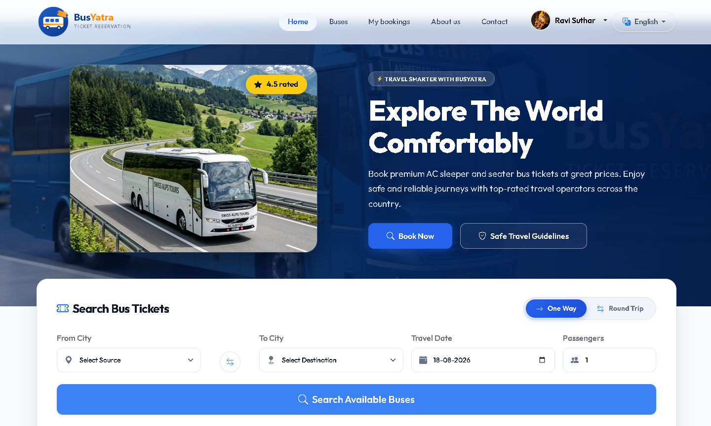
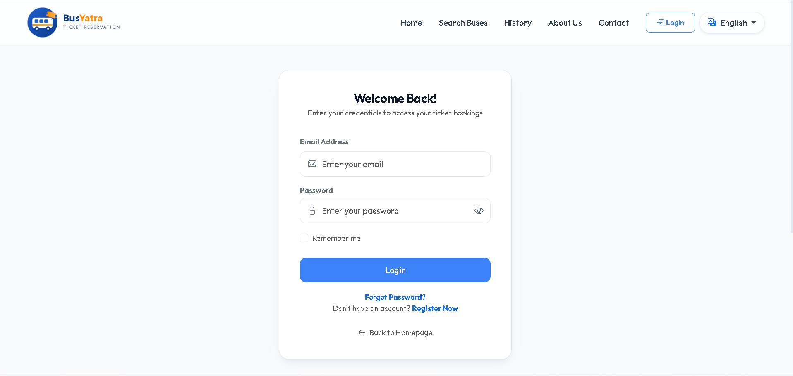
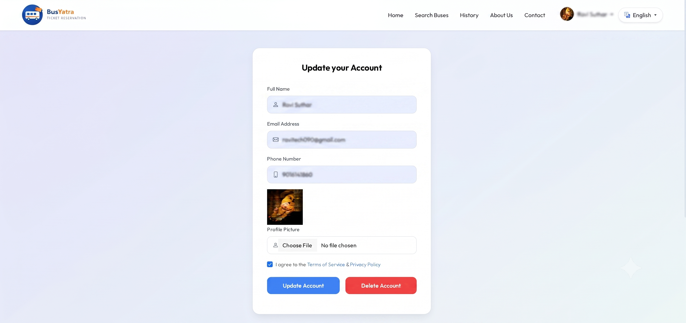
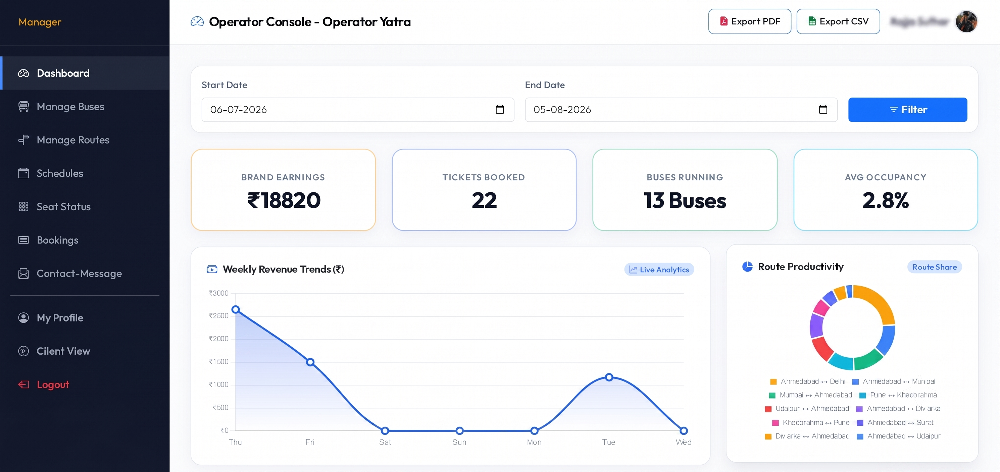

# 🚌 BusYatra

## Project Description

BusYatra is a modern, professional bus ticket reservation web application built with Python and Django. It provides an end-to-end digital ticketing platform that enables passengers to register, search bus routes across cities, view real-time interactive seat layouts, book seats for both one-way and round trips, make secure online payments via Razorpay, and instantly receive automated PDF e-tickets with scannable QR verification codes delivered directly to their email.

The platform implements Role-Based Access Control (RBAC) with dedicated management portals for **Customers**, **Bus Fleet Managers**, and **System Administrators**:
- **Customer Portal:** Search buses, interactive seat selection with automated seat locking (`SeatBooking`), Razorpay payment checkout, trip history categorization (Upcoming, Past, and Cancelled Trips), dynamic cancellation refund calculation, and verified passenger reviews.
- **Manager Portal:** Complete fleet management (CRUD) for buses, intercity routes, travel timetables, seat layout inspection, passenger manifest reviews, and operational PDF/CSV report exports.
- **Admin Portal:** Centralized command center providing platform-wide KPIs, complete user lifecycle management for customers and managers, financial payment audits, review curation, support inquiries, and system configuration including maintenance mode.

---

## Features

- **User Registration & Authentication:** Session-based authentication, user profile management, profile photo uploads, and email OTP-based password recovery.
- **Bus Search & Availability:** Search buses by origin, destination, and travel date with dynamic real-time seat availability and fare calculations.
- **Interactive Seat Booking:** Visual seat grid (window/aisle, sleeper/seater, upper/lower berths) with database-level seat locking to prevent double-booking.
- **Round-Trip Booking:** Seamless round-trip bus selection and unified checkout workflow with linked UUID (`round_trip_id`).
- **Razorpay Payments:** Integrated payment gateway supporting UPI, debit/credit cards, and net banking with automated sandbox fallback.
- **Automated PDF E-Ticket & Email:** In-memory dynamic PDF ticket generation with embedded QR verification code and automated Gmail SMTP delivery.
- **Cancellation & Dynamic Refund:** Self-service ticket cancellation adhering to system refund rules based on departure proximity.

---

## Installation & Setup

### Windows (PowerShell / Command Prompt)

```bash
# 1. Clone the repository
git clone https://github.com/ravi-1820/BusYatra-Project.git
cd BusYatra-Project

# 2. Navigate to the project directory containing manage.py
cd BusYatra

# 3. Create and activate a virtual environment
python -m venv venv
.\venv\Scripts\Activate.ps1
# For standard Command Prompt: venv\Scripts\activate.bat

# 4. Install required dependencies
pip install -r requirements.txt

# 5. Set up environment variables
copy .env.example .env

# 6. Apply database migrations
python manage.py makemigrations
python manage.py migrate

# 7. (Optional) Seed sample buses, routes, and operator data
python scripts\seed_buses.py

# 8. Create a superuser (admin account)
python manage.py createsuperuser

# 9. Start the development server
python manage.py runserver
```

---

### macOS / Linux (Terminal)

```bash
# 1. Clone the repository
git clone https://github.com/ravi-1820/BusYatra-Project.git
cd BusYatra-Project

# 2. Navigate to the project directory containing manage.py
cd BusYatra

# 3. Create and activate a virtual environment
python3 -m venv venv
source venv/bin/activate

# 4. Install required dependencies
pip install -r requirements.txt

# 5. Set up environment variables
cp .env.example .env

# 6. Apply database migrations
python3 manage.py makemigrations
python3 manage.py migrate

# 7. (Optional) Seed sample buses, routes, and operator data
python3 scripts/seed_buses.py

# 8. Create a superuser (admin account)
python3 manage.py createsuperuser

# 9. Start the development server
python3 manage.py runserver
```

---

## Admin Credentials

### Admin / Superuser Account
- **Username:** `admin1`
- **Email:** `admin1@gmail.com`
- **Password:** `admin1`

---

## Local Server Link

Once the development server is running, access the local application:

🔗 **[http://127.0.0.1:8000/](http://127.0.0.1:8000/)**

---

## Live Demo

🔗 **[https://ravisuthar.pythonanywhere.com/](https://ravisuthar.pythonanywhere.com/)**

---

## Screenshots

### 1. Home-page


### 2. Login-page


### 3. Profile-page


### 4. Buslist-page


### 5. Manager-dashboard


### 6. Admin-Dashboard


---