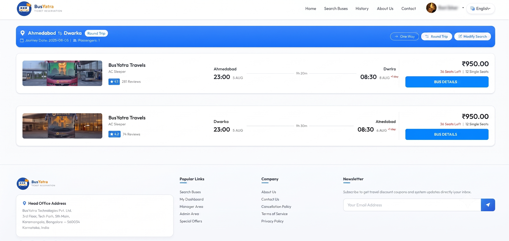
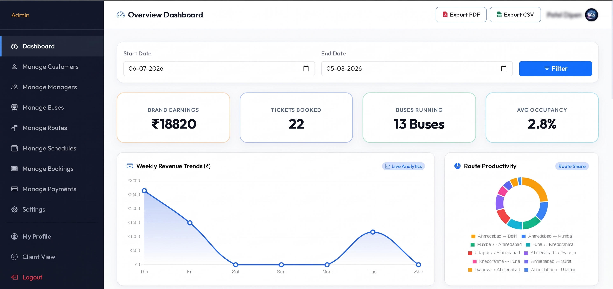

# 🚌 BusYatra

[](https://www.djangoproject.com/)
[](https://www.python.org/)
[](https://getbootstrap.com/)
[](https://www.sqlite.org/)
[](https://razorpay.com/)

---

## Project Description

BusYatra is a modern, professional bus ticket reservation web application built with Python and Django. It provides an end-to-end digital ticketing platform that enables passengers to register, search bus routes across cities, view real-time interactive seat layouts, book seats for both one-way and round trips, make secure online payments via Razorpay, and instantly receive automated PDF e-tickets with scannable QR verification codes delivered directly to their email.

The platform implements Role-Based Access Control (RBAC) with dedicated management portals for **Customers**, **Bus Fleet Managers**, and **System Administrators**:
- **Customer Portal:** Search buses, interactive seat selection with automated seat locking (`SeatBooking`), Razorpay payment checkout, trip history categorization (Upcoming, Past, and Cancelled Trips), dynamic cancellation refund calculation, and verified passenger reviews.
- **Manager Portal:** Complete fleet management (CRUD) for buses, intercity routes, travel timetables, seat layout inspection, passenger manifest reviews, and operational PDF/CSV report exports.
- **Admin Portal:** Centralized command center providing platform-wide KPIs, complete user lifecycle management for customers and managers, financial payment audits, review curation, support inquiries, and system configuration including maintenance mode.

---

## Features

- **User Registration & Authentication:** Session-based authentication, user profile management, profile photo uploads, and email OTP-based password recovery.
- **Bus Search & Availability:** Search buses by origin, destination, and travel date with dynamic real-time seat availability and fare calculations.
- **Interactive Seat Booking:** Visual seat grid (window/aisle, sleeper/seater, upper/lower berths) with database-level seat locking to prevent double-booking.
- **Round-Trip Booking:** Seamless round-trip bus selection and unified checkout workflow with linked UUID (`round_trip_id`).
- **Razorpay Payments:** Integrated payment gateway supporting UPI, debit/credit cards, and net banking with automated sandbox fallback.
- **Automated PDF E-Ticket & Email:** In-memory dynamic PDF ticket generation with embedded QR verification code and automated Gmail SMTP delivery.
- **My Orders Dashboard:** Customer booking history categorized into Upcoming Trips, Past Trips, and Cancelled Tickets with pagination.
- **Cancellation & Dynamic Refund:** Self-service ticket cancellation adhering to system refund rules based on departure proximity.
- **Customer Reviews & Ratings:** Verified passenger ratings (1 to 5 stars) and reviews with moderation and homepage showcase features.
- **Manager Dashboard:** Fleet, route, schedule, and seat management with downloadable PDF and CSV analytics reports.
- **Admin Command Center:** System-wide governance over all users, buses, schedules, routes, payment audit logs, and global platform settings.

---

## Installation & Setup

### Windows (PowerShell / Command Prompt)

```bash
# 1. Clone the repository
git clone https://github.com/ravi-1820/BusYatra-Project.git
cd BusYatra-Project

# 2. Navigate to the project directory containing manage.py
cd BusYatra

# 3. Create and activate a virtual environment
python -m venv venv
.\venv\Scripts\Activate.ps1
# For standard Command Prompt: venv\Scripts\activate.bat

# 4. Install required dependencies
pip install -r requirements.txt

# 5. Set up environment variables
copy .env.example .env

# 6. Apply database migrations
python manage.py makemigrations
python manage.py migrate

# 7. (Optional) Seed sample buses, routes, and operator data
python scripts\seed_buses.py

# 8. Create a superuser (admin account)
python manage.py createsuperuser

# 9. Start the development server
python manage.py runserver
```

---

### macOS / Linux (Terminal)

```bash
# 1. Clone the repository
git clone https://github.com/ravi-1820/BusYatra-Project.git
cd BusYatra-Project

# 2. Navigate to the project directory containing manage.py
cd BusYatra

# 3. Create and activate a virtual environment
python3 -m venv venv
source venv/bin/activate

# 4. Install required dependencies
pip install -r requirements.txt

# 5. Set up environment variables
cp .env.example .env

# 6. Apply database migrations
python3 manage.py makemigrations
python3 manage.py migrate

# 7. (Optional) Seed sample buses, routes, and operator data
python3 scripts/seed_buses.py

# 8. Create a superuser (admin account)
python3 manage.py createsuperuser

# 9. Start the development server
python3 manage.py runserver
```

---

## Admin Credentials

### Admin / Superuser Account
- **Username:** `admin1`
- **Email:** `admin1@gmail.com`
- **Password:** `admin1`
- **Admin Dashboard URL:** [http://127.0.0.1:8000/admin-dashboard/](http://127.0.0.1:8000/admin-dashboard/)

### Manager Account (Pre-seeded)
- **Username:** `manager1`
- **Email:** `manager1@gmail.com`
- **Password:** `manager1`
- **Manager Dashboard URL:** [http://127.0.0.1:8000/manager-dashboard/](http://127.0.0.1:8000/manager-dashboard/)

---

## Local Server Link

Once the development server is running, access the local application:

🔗 **[http://127.0.0.1:8000/](http://127.0.0.1:8000/)**

- **Customer Portal:** `http://127.0.0.1:8000/`
- **Admin Dashboard:** `http://127.0.0.1:8000/admin-dashboard/`
- **Manager Dashboard:** `http://127.0.0.1:8000/manager-dashboard/`
- **Django Standard Admin:** `http://127.0.0.1:8000/admin/`

---

## Live Demo

The production application is deployed and accessible at:

🔗 **[https://ravisuthar.pythonanywhere.com/](https://ravisuthar.pythonanywhere.com/)**

> **Note:** The live deployment runs in demonstration mode using Razorpay's sandbox payment environment and Gmail SMTP for notification emails.

---

## Screenshots

### 1. Home-page
Homepage featuring the interactive route search banner, featured routes, service highlights, and verified customer testimonials.


### 2. Login-page
User authentication portal with session login, password reset flow, and role-based redirect.


### 3. Profile-page
Customer account management panel for updating personal info, uploading profile photos, and managing account settings.


### 4. Buslist-page
Bus search results listing available buses, departure/arrival schedules, amenities, ticket pricing, and seat availability.


### 5. Manager-dashboard
Fleet manager control center displaying operational KPIs, active routes, booked seats, and analytical report export options.


### 6. Admin-Dashboard
System administrator dashboard providing platform-wide metrics, fleet oversight, user management, and global system configuration.


---

## 🛠️ Technology Stack

| Layer | Technology | Description |
| :--- | :--- | :--- |
| **Backend Framework** | Python 3.10+ / Django 5.x / 6.x | Robust Model-View-Template (MVT) web architecture |
| **Database** | SQLite3 | Local relational SQL database (`db.sqlite3`) |
| **Payment Gateway** | Razorpay Python SDK | Online payment order creation, checkout modal, and signature verification |
| **PDF Generation** | ReportLab 4.x / 5.x | Dynamic in-memory PDF e-ticket generation and operational reports |
| **QR Code Engine** | qrcode | Dynamic QR verification code generation for digital tickets |
| **Email Service** | Django SMTP (Gmail TLS) | Automated delivery of OTPs, booking confirmations, and e-tickets |
| **Image Processing** | Pillow (PIL) | Processing and resizing user profile avatars and bus exterior images |
| **Frontend Styling** | Bootstrap 5, Custom CSS & Font Awesome | Responsive mobile-first interface optimized for desktop and mobile |
| **Deployment / Server** | Gunicorn & WhiteNoise | Production WSGI server and static files management |

---

## 🧪 Running Automated Unit Tests

Automated tests are set up inside `Bus/tests.py` covering view responses, ticket generation logic, pagination, and seat isolation:

```bash
python manage.py test Bus
```

---

## Author / Developer

- **Developer:** Suthar Ravikumar K
- **GitHub:** [@ravi-1820](https://github.com/ravi-1820)
- **Repository:** [https://github.com/ravi-1820/BusYatra-Project.git](https://github.com/ravi-1820/BusYatra-Project.git)
- **Email:** [ravisuthar1820@gmail.com](mailto:ravisuthar1820@gmail.com) / [ravitech090@gmail.com](mailto:ravitech090@gmail.com)
- **Live Demo:** [https://ravisuthar.pythonanywhere.com/](https://ravisuthar.pythonanywhere.com/)

---

## License

This project is licensed under the [MIT License](LICENSE) — free to use and modify for personal and educational projects.
